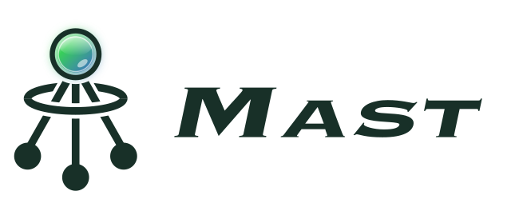

<p align="center">
  <picture>
    <source media="(prefers-color-scheme: dark)" srcset="docs/media/readme/mast-lockup-dark.png">
    
  </picture>
</p>

<p align="center"><em><a href="README.md">English</a> | 简体中文</em></p>

围绕一份工作大纲，指挥一群编码 agent。

Mast 是一个原生 macOS 应用，在聊天里运行 Claude Code、Codex、Cursor 和其他编码 agent（Devin、Grok、Hermes、Pi、Antigravity），并按这些聊天所属的工作来组织它们。会话存在你自己的机器上，不需要账号，也不需要联网。

<!--
## 截图

把截图放进 docs/media/readme/ 后取消注释：


-->

## 功能

- **工作大纲（Work Outline）。** 把聊天嵌套在工作项下：一个工作流、一张工单、一个 PR、一次调查。工作项带有聊天会继承的指令、聊天运行所在的仓库和 worktree，以及状态。全程可以用键盘操作。详见 [docs/work-outline.md](docs/work-outline.md)。
- **子聊天和协调者聊天。** 协调者聊天可以在自己的工作项或其后代上启动子聊天、读取子树、收集结果。子聊天通过各自的 Required Action 回报。
- **Required Actions。** agent 需要你做决定、审批，或者补充信息时，会提一个请求。请求会一直留在对应工作项上，直到你回答，你的回复会回到聊天里。
- **工作项指令。** 每个工作项一份指令，带修订记录，每次运行都会交给 Claude Code 和 Codex。编辑器支持 skill 自动补全。
- **PR 评审页。** 你自己的 PR 和待你评审的 PR 放在一起，按谁该动手分组，显示 CI、评论线程和冲突。可以为每个 PR 开一个评审聊天，已有的话直接打开。同步进来的 PR 会作为大纲里的工作项出现。评审启动器的说明见 [docs/pr-review.md](docs/pr-review.md)。
- **计划产物（Planning artifacts）。** agent 发布计划和图表（Markdown、HTML、Mermaid、图片），你在应用里阅读。修订之间可以做可视化对比：左右并排同步滚动、像素差异高亮、叠影，Markdown 则渲染后并排，并给改动的块上色。还有查找、章节索引，以及用来记录待决事项的问题卡片。给 agent 的约定见 [docs/planning-artifact-conventions.md](docs/planning-artifact-conventions.md)。
- **Linear。** 按 Space 单独开启。收件箱列出你的 issue 和 project，想要哪个就手动加进大纲。完整的工单会交给 agent。Mast 不会往 Linear 写任何东西。
- **按聊天指定的 diff 目标。** Changes 面板跟着 agent 建的 worktree（`bind_chat_worktree`），或者你选的分支、PR 走，这样你审的是 agent 的改动，而不是仓库根目录的 diff。
- **agent 工具。** 每个聊天都带有 `zeron-agent` MCP 服务：读取和更新自己的工作项、创建子项、提 Required Action、绑定 worktree、发布产物、启动和读取其他聊天。详见 [docs/mcp.md](docs/mcp.md)。
- **侧边浏览器。** 网页和 PR 链接在聊天旁边打开。

## 构建和运行（macOS）

Mast 需要从源码构建。你需要 macOS、Xcode 命令行工具，以及通过 [rustup](https://rustup.rs) 安装的 Rust（工具链版本固定在 `rust-toolchain.toml`）。

```bash
git clone https://github.com/Pluto8195/creel.git
cd creel
git checkout work-outline-implementation   # 默认分支

cargo build -p zeron                       # 调试版二进制在 target/debug/zeron
```

二进制和 crate 仍然叫 `zeron`，只有产品名改了。

以隔离的开发版应用运行：

```bash
scripts/run-macos-dev.sh
```

脚本会构建调试版二进制，打包成 `target/macos-dev/Mast Dev.app`，签名（有 Apple Development 证书就用它，否则用 ad-hoc 签名）并打开。开发版有自己的数据目录（`target/macos-dev/data`）、bundle id 和引擎端口，所以可以和已安装的 Mast 同时运行。设置 `ZERON_DEV_DATA_DIR` 或 `ZERON_DEV_IPC_PORT` 可以修改它们。

构建应用包和磁盘镜像：

```bash
scripts/package-macos.sh
```

脚本会构建 release 版二进制，在 `target/package/` 下生成 `Mast.app`，以及 `.dmg` 和自动更新用的 tarball。除非设置了 `CODESIGN_IDENTITY`，应用包只做 ad-hoc 签名，首次启动要右键 → 打开。发行文件名特意保留 `zeron-` 前缀。

引擎和它的同步代码继承自上游，仍然在代码树里，但 Mast 的用法是纯本地。`scripts/` 里还留着 Linux 和 Windows 的打包脚本，但 Mast 只在 macOS 上开发和测试。

## 文档

- [ARCHITECTURE.md](ARCHITECTURE.md)：引擎和 UI 怎么配合。
- [docs/work-outline.md](docs/work-outline.md)：工作大纲、快捷键、Linear、PR 评审同步。
- [docs/pr-review.md](docs/pr-review.md)：评审 PR 启动器。
- [docs/planning-artifact-conventions.md](docs/planning-artifact-conventions.md)：agent 如何发布计划。
- [docs/mcp.md](docs/mcp.md)：提供 agent 工具的 `zeron mcp` 服务。

## 致谢和许可

Mast 最初是 [zeronsh/zeron](https://github.com/zeronsh/zeron)（MIT）的 fork，曾短暂叫作 Creel，现在不再跟进上游。第三方声明见 [THIRD_PARTY_NOTICES.md](THIRD_PARTY_NOTICES.md)。

采用 [MIT License](LICENSE)。
